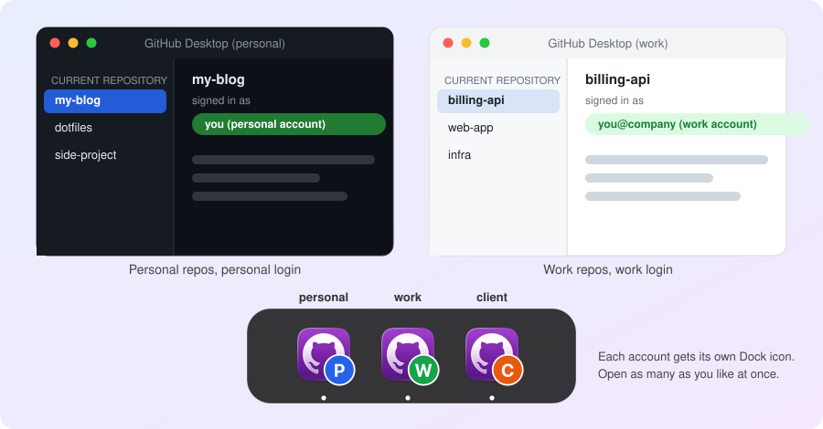
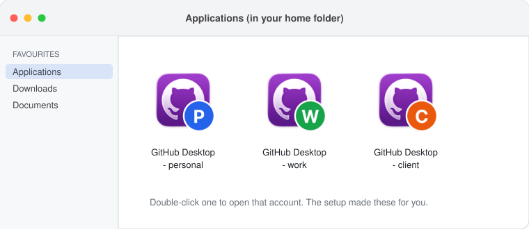

<div align="center">


<br>

**Run your work and personal GitHub accounts side by side in GitHub Desktop.**<br>
Separate logins, separate repo lists, the right email on every commit,<br>
and a guard that stops wrong-account commits before they happen.

[](https://github.com/shiv-exe-crashed/Github_on_steroids/actions/workflows/ci.yml)


[](LICENSE)

</div>

## The problem

GitHub Desktop signs in to only one github.com account at a time. With a work
and a personal account you sign out and in again, live with one mixed repo
list, and one tired click can push personal code to your company account (or
the other way round). That mistake stays in the history for good.

## What you get

<div align="center">

</div>

- **One launcher per account**, each with its own colored badge in the Dock.
- **Separate login, repo list and settings** per account. Open several at once.
- **The right name and email on every commit.** Your own Git settings are never touched.
- **A guard** that stops wrong-account commits and pushes with a clear message.
- **The official GitHub Desktop.** Nothing inside the app is changed, so updates keep working.
- No dependencies, no network calls from this tool, no admin rights.

## Install

You need macOS 12 or newer and [GitHub Desktop](https://desktop.github.com) in
your Applications folder. Nothing else.

1. Press **Cmd + Space**, type **Terminal**, press **Return**.
2. Paste this line and press **Return**:

   ```bash
   cd ~/Downloads && curl -fsSL https://github.com/shiv-exe-crashed/Github_on_steroids/archive/refs/heads/main.zip -o Github_on_steroids.zip && unzip -qo Github_on_steroids.zip && bash Github_on_steroids-main/install-mac.command
   ```

3. Answer the questions. Press **Return** to accept the suggested answer.

<div align="center">

</div>

The line downloads this project as a ZIP into your Downloads folder, unzips it
and starts the setup. It never asks for a password.

<details>
<summary>Other ways to get the code (read it first, or use GitHub Desktop)</summary>

**With GitHub Desktop:** choose **File, Clone Repository, URL**, paste
`https://github.com/shiv-exe-crashed/Github_on_steroids`, click **Clone**, then
**Repository, Show in Finder** and double-click `install-mac.command`.

**With Git in Terminal:**

```bash
cd ~/Documents
git clone https://github.com/shiv-exe-crashed/Github_on_steroids.git
bash Github_on_steroids/install-mac.command
```

</details>

### What to answer

Example for a personal and a work account (use your own names and emails):

| The setup asks | You type |
|---|---|
| Copy them into your first profile? | `y` if GitHub Desktop is signed in today. To see which account: in GitHub Desktop, **Settings, Accounts** |
| Name for profile 1 | `personal` |
| Email on commits | your GitHub noreply email (see the tip) |
| Folders | press **Return** to skip |
| GitHub owners | your GitHub username |
| Add another profile? | `y`, then `work`, `you@company.com`, `your-company` |
| Create these profiles? | `y` |

If your Git email is a GitHub noreply email, the setup first asks whether
GitHub Desktop is signed in to that same account (check **Settings, Accounts**
in GitHub Desktop). Type `y` and it shows a quick summary: press **Return**
once. Type `n` and you answer each question, and your Git email is offered for
your next profile instead.

**Tip, which email?** Use your GitHub noreply email so your real address never
shows in public commits: on github.com open **Settings, Emails**, tick **Keep
my email addresses private**, and copy the address that ends in
`@users.noreply.github.com`.

Every question is explained in [docs/USAGE.md](docs/USAGE.md).

### Open a profile and sign in

<div align="center">

</div>

The launchers are in the **Applications folder inside your home folder**
(`~/Applications`), **not** the main Applications folder. Finder's sidebar and
Launchpad don't show that folder, so at the end the setup offers to open your
first profile and then shows the launchers in Finder. Later, press **Cmd + Space** and type
the launcher's name, or in Finder choose **Go, Home**, then **Applications**.
Each new profile signs in once:

1. In your browser, check you are on the right GitHub account.
2. Close every other GitHub Desktop window.
3. Open the launcher, click **Sign in to GitHub.com**, **Continue With Browser**, **Authorize**.
4. On **Configure Git** choose **Configure manually** and click **Finish**.
5. Open **Settings, Accounts** and check it shows the right account.
6. Open **Settings, Git, Hooks** and keep **Load Git hook environment variables from shell** unticked (see below).

To add another account later, run the install line again and press **Return**
(choice 1, Add a profile). Your other profiles are not touched.

## The wrong-account guard

Before every commit, merge and push, a small guard checks that you are in the
right profile. Open a work repo in your personal profile by mistake and you see this:

<div align="center">

</div>

No commit is made. Open the same repo in the right profile and it just works.

| It stops | Example |
|---|---|
| A repo of another profile's GitHub owner | A `my-company/*` repo in the personal profile |
| A repo in another profile's folder | Something in `~/work` in the personal profile |
| A commit or push under the wrong email | Anything not made with this profile's email |

Your repos' own Git hooks (husky and friends) keep working: the guard runs
first, then hands over to them.

**A repo that belongs to someone else's account** (a teammate, a client)? Allow
just that one repo for the profile that should use it:

```bash
mac/ghdp allow work some-owner/shared-repo
```

**The guard is a safety net, not a lock.** GitHub Desktop has a setting,
**Settings, Git, Hooks, Load Git hook environment variables from shell**. Keep
it **off** (the default): then a wrong-account commit is simply refused. With it
**on**, GitHub Desktop adds an **Ignore and Continue** button that skips the
guard. We tested both. Not tested yet: that setting on **push**.

## Everyday use

You only need the launchers. For the rest:

| Command | What it does |
|---|---|
| `bash install-mac.command` | Setup. With profiles already there it shows a menu: add, remove, start over, refresh. |
| `mac/ghdp add` | Add one more profile, the others stay as they are |
| `mac/ghdp remove <name>` | Remove a profile (its data is kept unless you choose the Trash) |
| `mac/ghdp list` | Your profiles and a health check |
| `bash uninstall-mac.command` | Remove everything this tool made (it asks first) |

All commands, editing `profiles.json` by hand and updating: [docs/USAGE.md](docs/USAGE.md).

## Security

This tool sits next to your GitHub logins, so it is built like a security tool.

- It never reads, stores, prints or sends your tokens. GitHub Desktop keeps them in your Keychain, as before.
- No network calls, no telemetry, no auto-update. Checked by a test on every change.
- It checks GitHub Desktop's digital signature before every launch.
- Profile folders are readable by you only. No admin rights, and your `~/.gitconfig` is never edited.
- It refuses risky settings that would let other programs sneak code into GitHub Desktop.
- Three rounds of attacker-style review. Every weakness found was fixed and became a test.

Details: [how it works](docs/HOW_IT_WORKS.md), [threat model](THREAT_MODEL.md),
[security review](docs/SECURITY_REVIEW.md), [edge cases](docs/EDGE_CASES.md).
Found a problem? See [SECURITY.md](SECURITY.md).

## FAQ

<details>
<summary>Does it modify GitHub Desktop?</summary>

No. It starts the official, signed app with a separate data folder per
profile. For the Dock icon it opens a private copy of GitHub Desktop (instant
and free on disk, because Macs clone files) in a hidden folder,
`~/Applications/.gh-desktop-profiles/`. If a copy can't be made, the normal
app opens. Skip the copy with `mac/ghdp launch <name> --plain`.
</details>

<details>
<summary>Why do the windows still say "GitHub Desktop" in the menu bar and Mission Control?</summary>

Only the icon is different. macOS reads the app name from files that are part
of the app's security seal. Changing it breaks the seal, and macOS then refuses
to open the app ("damaged and can't be opened"). We tried and dropped it on
purpose. To tell windows apart, use the Dock icon and give each profile its own
theme (Light or Dark) in **Settings, Appearance**.
</details>

<details>
<summary>GitHub Desktop asks "Move GitHub Desktop to the Applications folder?"</summary>

Click **Not Now**, never **Move and Restart** (it could replace the real app).
The private copies live inside an Applications folder to avoid this question,
so tell us if you still see it.
</details>

<details>
<summary>How many accounts can I use?</summary>

Up to 20 profiles: work, personal, open source, one per client. Add one later
by running the install line again.
</details>

<details>
<summary>Can I use the same account in two profiles?</summary>

Yes, but they share one saved login: signing out in one signs out the other.
</details>

<details>
<summary>Does it send data anywhere?</summary>

The tool makes no network calls. GitHub Desktop itself can send usage stats:
untick **Settings, Advanced, usage stats** in each profile if you don't want that.
</details>

<details>
<summary>Does it work with company single sign-on?</summary>

Yes. Sign-in is GitHub Desktop's normal browser sign-in, so your company's
usual login page appears.
</details>

## Uninstall

Double-click **`uninstall-mac.command`**. It asks before doing anything, removes
the launchers, the tool and the private copies, and asks whether to move your
profile data to the Trash. Your normal GitHub Desktop, your code and your GitHub
accounts are never touched. Saved logins stay in your Keychain: to remove one,
sign out inside that profile first.

When it is done, you can delete the folder you downloaded or cloned (and
`Github_on_steroids.zip` in Downloads, if you used the install line). Nothing
needs them any more.

## Troubleshooting

| You see | Do this |
|---|---|
| *"install-mac.command" cannot be opened* | It came from a browser download. Use the install line above, which avoids this. |
| Sign-in keeps waiting | Close every other GitHub Desktop window, then sign in again. |
| *GitHub Desktop failed the signature check* | Reinstall GitHub Desktop from [desktop.github.com](https://desktop.github.com). |
| *The setting NODE_OPTIONS is turned on* | Something set a risky setting for your whole session. Remove it from your shell files and run `launchctl unsetenv NODE_OPTIONS`. |
| *Commit failed: gh-desktop-profiles stopped this* | The guard doing its job. Open the repo in the profile it names. |
| A profile shows another account's repos | Right-click them, **Remove** (files stay on disk), then add them in the right profile. |
| Anything else | `mac/ghdp list` runs a health check. Every error says what to do next. |

## Contributing

Ideas, bug reports and pull requests are welcome. Please read
[CONTRIBUTING.md](CONTRIBUTING.md) first.

<div align="center">

If this saved you from a wrong-account push, a star helps others find it.

[MIT License](LICENSE)

<sub>An independent open-source project. It is not made by, affiliated with, or endorsed by GitHub, Inc.
"GitHub" and "GitHub Desktop" are trademarks of GitHub, Inc. This tool only starts the official app
and does not change it.</sub>

</div>
