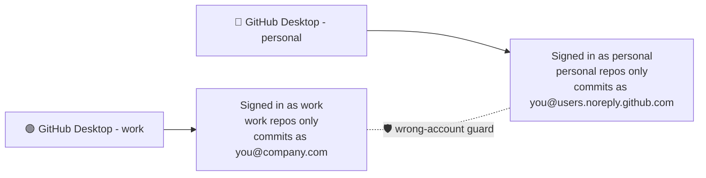

<div align="center">


<br>

**Run your work and personal GitHub accounts side by side in the official GitHub Desktop.**<br>
Separate logins. Separate repos. The right email on every commit.<br>
And a guard that **stops wrong-account commits before they happen.**

<br>

[](https://github.com/shiv-exe-crashed/Github_on_steroids/actions/workflows/ci.yml)


[](LICENSE)

[**⚡ Install in 2 minutes**](#-install-in-2-minutes) ·
[✨ Features](#-features) ·
[🧭 Setup questions](#-setup-questions-explained) ·
[🛡️ Guard](#%EF%B8%8F-the-wrong-account-guard) ·
[🧩 Edge cases](#-edge-cases-handled) ·
[🔒 Security](#-security-first) ·
[❓ FAQ](#-faq)

</div>

---

<div align="center">

| 🧪 **86** automated tests | 🧨 **5** attack tests | 💬 **73** error messages, each with a next step | 🔗 **15** Git hooks kept working | 📦 **0** dependencies | 🌐 **0** network calls |
|:---:|:---:|:---:|:---:|:---:|:---:|

</div>

## 😩 The problem

GitHub Desktop signs in to only **one** github.com account at a time. If you
have a work account and a personal one, you know the routine:

- 🔁 **Sign out, sign in, repeat.** Every switch costs minutes.
- 🗂️ **One mixed repo list.** Work and personal projects side by side.
- 😬 **One tired click.** Personal code lands in your company account, or a
  work commit carries your personal email. Forever, in the history.

## ✨ The fix

Every account gets its own **profile**: its own launcher, login, repo list and
settings. Switching is one click, and both can be open at once.



It runs the **official, signed GitHub Desktop**. Nothing inside the app is
changed, so updates keep working.

<div align="center">

</div>

---

## 🚀 Features

| | |
|---|---|
| 🖱️ **One click per account** | A launcher app per profile, each with its own colored letter badge. Open it from Applications, Spotlight or your Dock. |
| 🗂️ **Truly separate** | Own login, repo list, settings and theme per profile. Nothing leaks between them. |
| 👥 **As many accounts as you need** | Not just two: work, personal, open source, every client… up to **20 profiles**. |
| 🪟 **Side by side** | Open several profiles at once. Click one again and its window comes to the front, never a duplicate. |
| 🪪 **The right identity, every commit** | Each profile commits with its own name and email. Your global `~/.gitconfig` is never touched. |
| 🛡️ **Wrong-account guard** | Commits, merges and pushes in the wrong profile are stopped with a clear message that names the right profile. |
| 🪄 **Guided setup** | A friendly wizard asks a few questions. No config files to edit. |
| ⚡ **No sign-in for your current account** | Setup can copy your current GitHub Desktop into the first profile, so it opens already signed in, with your repos. |
| 🔒 **Security first** | Never touches your tokens, verifies GitHub Desktop's signature before every launch, keeps profile data private. |
| 📦 **Zero dependencies** | Plain bash and tools that ship with macOS. Works offline. One readable file. |
| 🧹 **Clean, reversible uninstall** | Removes only what it made. Your data goes to the Trash only if you say so. |

### 🤔 Why not just…?

| | Sign out & in | SSH keys + Git config tricks | GitHub Desktop beta (multi-account) | **GitHub Desktop Profiles** |
|---|:---:|:---:|:---:|:---:|
| One-click switch in GitHub Desktop | ❌ | ❌ | ✅ | ✅ |
| Separate repo list per account | ❌ | ❌ | ❌ one shared list | ✅ |
| Right email per account, automatically | ❌ | ⚠️ by folder, set up by hand | ❌ author is not changed | ✅ |
| Stops wrong-account commits and pushes | ❌ | ❌ | ❌ | ✅ |
| Official, unmodified GitHub Desktop | ✅ | ✅ | ✅ beta channel | ✅ stable |

---

## ⚡ Install in 2 minutes

**You need:**
- macOS 12 or newer
- [GitHub Desktop](https://desktop.github.com) in your Applications folder

### 1️⃣ Get the code

Pick one:

- **With GitHub Desktop (easiest):** on this page click **Code → Open with
  GitHub Desktop**, then **Clone**.
- **With Terminal:**
  ```bash
  git clone https://github.com/shiv-exe-crashed/Github_on_steroids.git
  ```
- **As a ZIP:** click **Code → Download ZIP** and unzip it. Use the Terminal
  command in step 2: macOS blocks double-clicking files that came from a
  browser download.

### 2️⃣ Run the setup

In Finder, open the folder and **double-click `install-mac.command`**.

> Downloaded a ZIP? Run it from Terminal instead:
> ```bash
> cd ~/Downloads/Github_on_steroids-main && bash install-mac.command
> ```

### 3️⃣ Answer a few questions

The wizard explains itself as it goes. The full list is just below:
[setup questions explained](#-setup-questions-explained).

### 4️⃣ Open your profiles

In Finder press **Shift + Cmd + H**, open **Applications**, and double-click
**GitHub Desktop - &lt;name&gt;**. Or press **Cmd + Space** and type its name.

New profiles sign in once: see [first sign-in](#-first-sign-in). That's it. 🎉

---

## 🧭 Setup questions explained

Press **Return** to accept the value shown in `[brackets]`. Never type a
password here: you sign in later, inside GitHub Desktop.

| The wizard asks | What it means | What to type |
|---|---|---|
| **Start a new setup?** *(only if you already have profiles)* | Replace your profiles. Your old settings are backed up. | **n** keeps your profiles and reinstalls the launchers. **y** starts over. |
| **Copy them into your first profile…?** *(only if GitHub Desktop is already set up)* | Turn your current GitHub Desktop (its login and repo list) into your first profile, so that account doesn't sign in again. The original is never changed. | **y** (recommended) |
| **Name for profile 1** | A short name for this profile. It becomes the launcher name, e.g. "GitHub Desktop - work". | `work`, `personal`, `opensource`… (letters, numbers, `-` and `_`) |
| **Name on commits** | The author name shown on commits from this profile. | Your name |
| **Email on commits for this account** | The email on commits from this profile. | That account's email, e.g. its GitHub **noreply** email (github.com → Settings → Emails). |
| **Folders used ONLY for this account's repos** *(optional)* | Where this account's repos live. The guard then knows a repo there belongs to this profile. | e.g. `~/work`. **Skip** it if work and personal repos share a folder. |
| **GitHub owners for this account** *(recommended)* | The GitHub username and organizations this account works with: the part after `github.com/` in a repo link. | e.g. `my-company, my-work-username` |
| **Add GitHub owners now?** *(only if you skipped both)* | Without folders or owners, the guard can only check the email. | **y** (recommended) |
| **Add another profile?** | Set up your next account. | **y** for each extra account, then **n** |
| **Create these profiles?** | A last look at the summary. | **y** |
| **Please quit GitHub Desktop now** *(when copying)* | The copy needs GitHub Desktop closed, so its data is complete. | Press **Cmd + Q** in GitHub Desktop, then **Return** |

> [!TIP]
> If you used to switch accounts inside one GitHub Desktop, the copied profile
> also gets the other account's repos. Setup reminds you to remove them there
> (right-click → **Remove**; the files stay on your disk) and to add them in
> the right profile (**File → Add Local Repository**).

---

## 🔑 First sign-in

Each new profile signs in **once**:

1. In your **browser**, open github.com and check that you're on the **right
   account**.
2. Make sure **no other GitHub Desktop window is open**.
3. Open the profile's launcher → **Sign in to GitHub.com → Continue With
   Browser** → **Authorize** → allow "Open GitHub Desktop".
4. On **Configure Git**, choose **Configure manually**. You'll see this
   profile's name and email. Click **Finish**.
5. Check **Settings → Accounts**: it shows the right account. ✅

> [!TIP]
> Give each profile its own theme (**Settings → Appearance**), for example
> Light for work and Dark for personal. You'll always know which window is
> which.

---

## 🛡️ The wrong-account guard

Before every commit, merge and push, a small guard checks that you're in the
right profile. Open a work repo in your personal profile by mistake, and this
is what you see:

<div align="center">

</div>

**No commit is made.** Open the same repo in the work profile, and it just
works.

| It stops | Example |
|---|---|
| A repo of another profile's GitHub owner | A `my-company/*` repo in the personal profile |
| A repo in another profile's folder | Something in `~/work` in the personal profile |
| A commit with the wrong email | Anything that would not use this profile's email |
| A push of new commits made under another email | Commits made outside this profile, pushed from it |
| A push to an owner this profile doesn't use | Pushing to a fork owned by the other account |

Your repos' own Git hooks (husky, pre-commit and friends) **keep working**:
the guard runs first, then hands over to them.

### 👥 Working on a repo that belongs to someone else's account

Teams share repos: a teammate's personal account, a client's organization, or
your own other account added as a **collaborator**. The guard blocks these by
default, because the owner is not one of the profile's owners. Allow **just
that one repo** for the profile that should use it:

```bash
mac/ghdp allow work some-owner/shared-repo
```

- It takes effect at once. No restart, no setup.
- Only that repo is allowed. Other repos of `some-owner` stay protected, and
  the email check still applies.
- You can paste the repo link too: `mac/ghdp allow work https://github.com/some-owner/shared-repo`.
- See what you allowed with `mac/ghdp list`. Undo it by deleting the repo from
  `"repos"` in `profiles.json`, then run `mac/ghdp install`.

> [!NOTE]
> The guard is only a safety net on your Mac. Whether an account **may** push
> to a repo is decided by GitHub: add the account as a collaborator there first.

---

## 🧩 Edge cases handled

The difference between a script and a tool you can trust. Every row below is
handled on purpose. Almost all are covered by automated tests; the rest
(like a double-click on a launcher) were checked by hand.

<details open>
<summary><b>🔀 Git and GitHub</b></summary>

| Situation | What happens |
|---|---|
| A repo uses its own hooks folder (husky) | The guard can't be switched off by it, and the repo's hooks still run. |
| You merge `main` into your branch, or merge pull requests on github.com | Never flagged: only your **new** commits (not on GitHub yet) are checked. |
| Merge commits | Checked like normal commits. |
| SSH host aliases (`work-github:company/repo`) | Understood; the owner is checked as usual. |
| A force-push the guard can't fully see | The push is stopped instead of guessed. |
| A token hidden in a remote URL (`https://user:token@…`) | Never shown on screen. |
| A remote URL with a newline or odd characters | Refused safely, never run. |
| A local backup remote with spaces in its path | Works. |
| A repo opened from a browser link lands in the wrong profile | The first commit is stopped, naming the right profile. |

</details>

<details open>
<summary><b>🗂️ Profiles and setup</b></summary>

| Situation | What happens |
|---|---|
| Two names that differ only in capitals (`Work` vs `work`) | Treated as the same, because Mac folders ignore case. |
| A profile renamed (`my_work` → `my-work`) or removed | Its old launcher and guard rules are cleaned up. |
| A typo in a setting (`gitEmial`) | Refused with a clear message, never silently ignored. |
| Wrong types, nested objects, line breaks in settings | Each is refused with a message that says what to fix (21 broken-config cases tested). |
| Setup run twice | Nothing breaks or doubles up. Settings GitHub Desktop added to a profile are kept. |
| Setup cancelled before you confirm | Nothing is written. |
| A copy interrupted halfway | The partial copy never counts as profile data. |
| GitHub Desktop still open while copying | Setup waits until it's closed, so the data is complete. |
| A launcher clicked twice | No second window: the existing one comes to the front. |
| 20 profiles | Still fast: settings load in about a second. |

</details>

<details open>
<summary><b>🔐 Safety</b></summary>

| Situation | What happens |
|---|---|
| A damaged or fake GitHub Desktop | Signature check fails; nothing opens. |
| A risky Electron setting (`NODE_OPTIONS`) is set | The launch is refused, with steps to fix it. |
| A symlink planted to redirect a write | Refused, or replaced, never written through. |
| Another user can write to `~/Applications` | Launchers are not installed there until it's fixed. |
| A profile folder with loose permissions | Fixed to owner-only on the next run. |
| An empty variable in a delete | Impossible: every recursive delete is guarded. |

</details>

---

## 🔒 Security first

This tool sits next to your GitHub logins, so it was built like a security
tool:

- 🔑 **Never touches your tokens.** It has no code to read, store, print or
  send them. GitHub Desktop keeps them in your macOS Keychain, as always.
- 🌐 **No network calls. No telemetry. No auto-update.** Checked
  automatically on every change.
- ✍️ **Verifies GitHub Desktop before every launch:** its code signature must
  belong to GitHub (Team ID `VEKTX9H2N7`).
- 🧱 **Private by default:** profile folders are readable by you only, and
  this is checked on every run.
- 🚫 **Refuses risky settings** that would let other programs run code inside
  GitHub Desktop.
- 🙅 **No admin rights, no system changes.** Your `~/.gitconfig` is never
  edited.
- 🧪 **Reviewed like an attacker would:** two rounds of review; every
  weakness found was fixed and turned into a test.

📖 [How it works](docs/HOW_IT_WORKS.md) ·
[Threat model](THREAT_MODEL.md) ·
[Security review](docs/SECURITY_REVIEW.md) ·
[Report a problem](SECURITY.md)

### 🔍 Don't trust us, check it yourself

- The whole tool is **one readable file**: [`mac/ghdp`](mac/ghdp).
- See the exact command a launcher runs, without running it:
  ```bash
  mac/ghdp launch work --dry-run
  ```
- Confirm there are no network commands or `eval`:
  ```bash
  bash scripts/check-policy.sh
  ```
- Run the test suite (it uses a throwaway home folder):
  ```bash
  brew install bats-core && bats tests/mac
  ```

---

## 🛠️ Everyday commands

The launchers are all you need day to day. For everything else:

| Command | What it does |
|---|---|
| `bash install-mac.command` | Guided setup. Run it again to add, rename or remove profiles. |
| `mac/ghdp list` | Your profiles, their guard rules, and a health check |
| `mac/ghdp allow <name> <owner/repo>` | Let a profile use one repo of an owner it doesn't use |
| `mac/ghdp install` | Rebuild launchers after editing your profiles by hand |
| `mac/ghdp launch <name>` | Open a profile from Terminal (add `--dry-run` to only show the command) |
| `bash uninstall-mac.command` | Remove everything this tool made (it asks first) |

<details>
<summary><b>✍️ Prefer editing settings by hand?</b></summary>

Profiles live in `~/Library/Application Support/gh-desktop-profiles/profiles.json`.
Edit it, then run `mac/ghdp install`:

```json
{
  "version": 1,
  "profiles": [
    { "name": "work", "gitName": "Your Name", "gitEmail": "you@company.com",
      "owners": ["my-company", "my-work-username"] },
    { "name": "personal", "gitName": "Your Name", "gitEmail": "12345+you@users.noreply.github.com",
      "owners": ["my-personal-username"] }
  ]
}
```

Optional per profile: `"folders": ["~/work"]`, `"owners": [...]` and
`"repos": ["some-owner/shared-repo"]` (single repos of other owners; see
[`mac/ghdp allow`](#-working-on-a-repo-that-belongs-to-someone-elses-account)).
</details>

**Updating:** pull the latest version (in GitHub Desktop: **Fetch** → **Pull**),
then double-click `install-mac.command` and answer **n** to "Start a new
setup?". Your launchers are refreshed and your profiles stay.

---

## 🗑️ Uninstall

Double-click **`uninstall-mac.command`**:

1. It asks before doing anything.
2. It removes the launchers and the tool.
3. It asks whether to move your profile data to the **Trash** (you can put it
   back).

Your normal GitHub Desktop, your code and your GitHub accounts are never
touched.

> [!NOTE]
> Saved logins stay in your Keychain. To remove one, sign out inside that
> profile first, but only if no other window uses that account.

---

## ❓ FAQ

<details>
<summary><b>Does it modify GitHub Desktop?</b></summary>

No. It starts the official, signed app with a separate data folder per
profile. Nothing inside the app is changed, and updates keep working.
</details>

<details>
<summary><b>Several people (or accounts) work on the same repo. Does the guard get in the way?</b></summary>

Only on your own Mac, and only for **your** profiles. Your teammates are not
affected. For a repo whose owner your profile doesn't use, run
`mac/ghdp allow <profile> <owner/repo>` once. See
[Working on a repo that belongs to someone else's account](#-working-on-a-repo-that-belongs-to-someone-elses-account).
Everything under an owner your profile **does** use (for example your whole
company organization) works without any extra step.
</details>

<details>
<summary><b>Can I use more than two accounts?</b></summary>

Yes, up to 20 profiles. Work, personal, open source, each client: one launcher
each.
</details>

<details>
<summary><b>Can I have work and personal open at the same time?</b></summary>

Yes. Each profile runs in its own window. Give them different themes to tell
them apart.
</details>

<details>
<summary><b>Does it work with company single sign-on (SSO)?</b></summary>

Sign-in is GitHub Desktop's normal browser sign-in, so your company's usual
login page appears as it always does.
</details>

<details>
<summary><b>Where are my passwords and tokens?</b></summary>

GitHub Desktop keeps them in your macOS Keychain, exactly as before. This tool
never reads or copies them.
</details>

<details>
<summary><b>Why do both windows show the same icon in the Dock?</b></summary>

A running window always shows GitHub Desktop's own icon. Changing that would
mean changing the app itself, which this tool never does. The colored badges
are on the launchers: drag them into your Dock for one-click access. Use Light
and Dark themes to tell open windows apart.
</details>

<details>
<summary><b>Can I use the same account in two profiles?</b></summary>

You can, but they share one saved login: signing out in one signs out the
other.
</details>

<details>
<summary><b>Does it send any data anywhere?</b></summary>

No. The tool makes no network calls at all. GitHub Desktop itself can send
usage stats: untick **Settings → Advanced → usage stats** in each profile if
you don't want that.
</details>

<details>
<summary><b>Is it free?</b></summary>

Yes, MIT licensed. Use it, share it, improve it.
</details>

---

## 🩺 Troubleshooting

| You see | Do this |
|---|---|
| *"install-mac.command" cannot be opened* | It came from a browser download. Run `bash install-mac.command` in Terminal from that folder, or clone with GitHub Desktop instead. |
| Sign-in keeps waiting | Close every other GitHub Desktop window, then sign in again. |
| *GitHub Desktop … failed the signature check* | Reinstall GitHub Desktop from [desktop.github.com](https://desktop.github.com). |
| *The setting NODE_OPTIONS is turned on…* | Something set a risky setting for your whole session. Remove it from your shell files and run `launchctl unsetenv NODE_OPTIONS`. |
| *Commit failed: gh-desktop-profiles stopped this…* | That's the guard doing its job. Open the repo in the profile it names. |
| A profile shows another account's repos | Right-click them → **Remove** (files stay on disk), then add them in the right profile. |
| Anything else | `mac/ghdp list` runs a quick health check. Every error message says what to do next. |

---

## 🤝 Contributing

Ideas, bug reports and pull requests are very welcome. Please read
[CONTRIBUTING.md](CONTRIBUTING.md) first. For security problems, see
[SECURITY.md](SECURITY.md).

<div align="center">

### ⭐ If this saved you from even one wrong-account push, give it a star!

It helps other developers with two GitHub accounts find it.

Made with ❤️ for everyone juggling work and personal GitHub · [MIT License](LICENSE)

</div>
