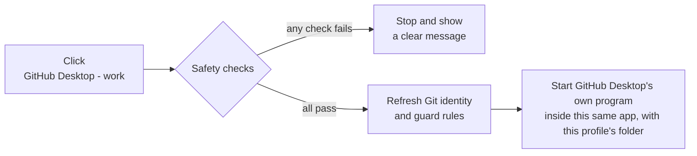

# How it works

A short, honest look under the hood. Everything here was checked against
GitHub Desktop 3.6.11 on macOS, with links to GitHub Desktop's own source
code (pinned to that release's commit).

## The core idea: one data folder per account

GitHub Desktop is an [Electron](https://www.electronjs.org/) app. Electron
apps accept a `--user-data-dir` switch, which tells the app where to keep
everything it remembers. A different folder gives a completely separate
GitHub Desktop:

| Kept per profile | Where GitHub Desktop stores it |
|---|---|
| Signed-in account list | localStorage, key `users` ([accounts-store.ts](https://github.com/desktop/desktop/blob/0102f49aa6c8c554de558299f31b6129b502a2fe/app/src/lib/stores/accounts-store.ts#L402)) |
| Repository list | IndexedDB |
| Settings, theme, window size | localStorage and files in the folder |
| Logs | `logs/` in the folder |

GitHub Desktop's single-window lock ([main.ts](https://github.com/desktop/desktop/blob/0102f49aa6c8c554de558299f31b6129b502a2fe/app/src/main-process/main.ts#L178))
is also per data folder:
- Two profiles run side by side.
- Opening the same profile twice just brings its window to the front.

Your installed GitHub Desktop is never changed. Each profile app is a copy of
it with its own name, icon and start file, signed on your Mac (an ad-hoc
signature, because GitHub's signature cannot cover a different icon). The
copy is remade when GitHub Desktop updates or when any file in it changes.

## What a profile looks like on disk

```
~/Library/Application Support/gh-desktop-profiles/      (700, only you)
├── profiles.json            your profiles, written by the setup wizard (600)
├── bin/ghdp                 the installed copy of the tool that launchers run
└── profiles/<name>/
    ├── desktop-data/        GitHub Desktop's data for this profile
    ├── gitconfig            this profile's Git settings
    ├── guard.rules          this profile's guard rules (made from profiles.json)
    └── hooks/               the wrong-account guard

~/Applications/GitHub Desktop - <name>.app   one app per profile (a copy of GitHub Desktop)
```

## What happens when you click a launcher



The safety checks, in order:

1. The profile name and `profiles.json` are valid (strict rules, unknown keys refused).
2. Every profile folder is a real folder (not a link), owned by you, and
   private (`700`, files `600`, extra access rules removed). Wrong modes are
   fixed on the spot.
3. The tool's own file is yours and not writable by anyone else.
4. `NODE_OPTIONS` and `ELECTRON_RUN_AS_NODE` are not set. GitHub Desktop
   ships with these Electron switches turned on; if they were set, another
   program could run code inside it.
5. `/Applications/GitHub Desktop.app` passes `codesign --verify --deep --strict`,
   pinned to GitHub's Apple Team ID `VEKTX9H2N7` and bundle id
   `com.github.GitHubClient`. A fake or damaged app is never opened.

Then GitHub Desktop is started with fixed arguments only:

```
open -n -a "/Applications/GitHub Desktop.app" \
  --env GIT_CONFIG_GLOBAL=<profile>/gitconfig \
  --env GIT_AUTHOR_NAME=…  --env GIT_AUTHOR_EMAIL=… \
  --env GIT_COMMITTER_NAME=…  --env GIT_COMMITTER_EMAIL=… \
  --env GIT_CONFIG_COUNT=1 --env GIT_CONFIG_KEY_0=core.hooksPath \
  --env GIT_CONFIG_VALUE_0=<profile>/hooks \
  --args --user-data-dir=<profile>/desktop-data
```

Those settings reach only that one GitHub Desktop process: not your shell,
not other apps. You can see the exact command any time with
`mac/ghdp launch <name> --dry-run`.

## Your commit identity

- `GIT_AUTHOR_*` and `GIT_COMMITTER_*` beat every Git config file, so commits
  made in a profile always carry that profile's name and email.
- `GIT_CONFIG_GLOBAL` points Git at the profile's own `gitconfig`. That file
  first includes your normal `~/.gitconfig` (aliases, LFS and so on keep
  working), then sets this profile's name and email.
- Your real `~/.gitconfig` is **never** edited.

## The wrong-account guard

Each profile has a small hooks folder. Git is pointed at it with
`GIT_CONFIG_COUNT` (command-line scope). This beats a repo's own hooks
setting, so tools like husky cannot switch the guard off.

| Moment | What is checked |
|---|---|
| Before a commit (and a merge commit) | The commit email is the profile's email. The repo is not in another profile's folders or owned by another profile's GitHub owner. If this profile has its own folders or owners, the repo must match them. |
| Before a push | The push URL's owner, the repo folder, and the committer email of every **new** commit (one that is on no remote yet). Teammates' commits and pull requests merged on GitHub are never flagged. If the commits cannot be listed, the push is stopped. |

If a check fails, GitHub Desktop shows "Commit failed" with a plain message
that names the right profile. Then the guard runs the repo's **own** hook
for that event, so existing hooks keep working.

The guard only reads repo values as text: remote URLs are shown without any
`user:token@` part, and control characters are removed from messages.

## Signing in

GitHub Desktop signs in through your browser. GitHub then sends the result
back to "GitHub Desktop" through a link
(`x-github-desktop-auth://…`), and macOS hands it to a running GitHub
Desktop window. So:

- Sign in to a profile while **it is the only GitHub Desktop window open**.
  You only do this once per profile.
- Before you click "Sign in", check that your browser is on the right GitHub
  account.

A reply that reaches the wrong window is simply ignored, because GitHub
Desktop checks a secret `state` value
([sign-in-store.ts](https://github.com/desktop/desktop/blob/0102f49aa6c8c554de558299f31b6129b502a2fe/app/src/lib/stores/sign-in-store.ts#L365)).

## Where your login lives (and why the tool never touches it)

- GitHub Desktop stores tokens in the macOS **Keychain**. The service name is
  `GitHub - https://api.github.com`, and the account is your GitHub username
  ([credential-sessions.ts](https://github.com/desktop/desktop/blob/0102f49aa6c8c554de558299f31b6129b502a2fe/app/src/lib/credential-sessions.ts#L175)).
- Two different accounts get two separate Keychain items.
- gh-desktop-profiles never reads, copies, prints or deletes any of them.

Because the item is keyed by username, the **same** account used in two
profiles (or in a profile and your normal GitHub Desktop) shares one
item. Signing out in one signs out the other.

## Copying your current GitHub Desktop (optional, during setup)

Setup can copy your current GitHub Desktop data into the first profile, so
that account opens already signed in, with its repo list:

- The original is only **read**, never changed.
- Caches, logs, cookies and lock files are skipped. So are links that point
  outside the folder (`rsync --safe-links`).
- It waits until GitHub Desktop is closed. It checks the app's database lock
  files, so it never copies a half-written database.
- The token is not copied (it is in the Keychain), and the copy is
  owner-only.

**Quick setup.** If your Git email (from `git config user.email`, the only
thing read for this) is a GitHub noreply email such as
`12345+name@users.noreply.github.com`, setup asks whether your current GitHub
Desktop is signed in to the account `name`. You check this in GitHub Desktop's
**Settings, Accounts**, and the question has no default answer. On **y** it
names the profile `name`, uses `name` as the guard's owner, shows a summary and
asks once. On **n** you answer each question, and the Git email is offered for
your next profile instead of the copied one. It never reads GitHub Desktop's
account files or tokens for this. Those files also keep accounts you signed
out of, so they could not tell which account is signed in now. At the end,
and only when a person is typing, it offers to open the new profile and then
shows the launchers in Finder.
